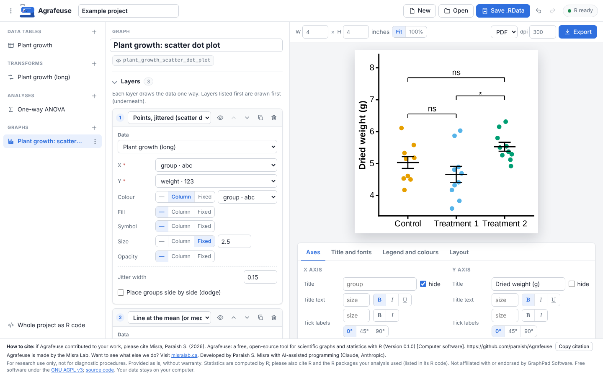
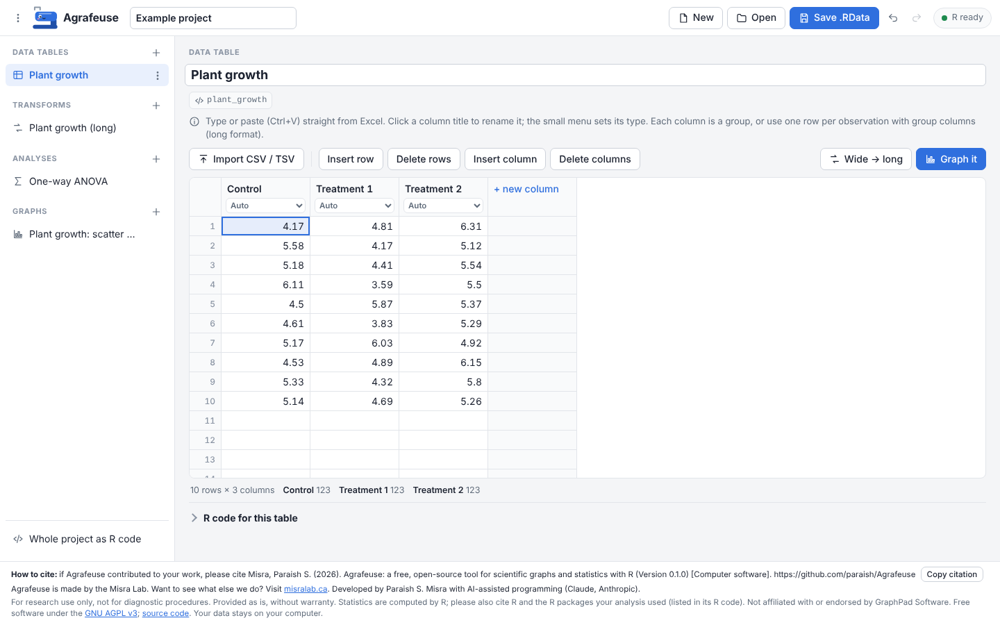
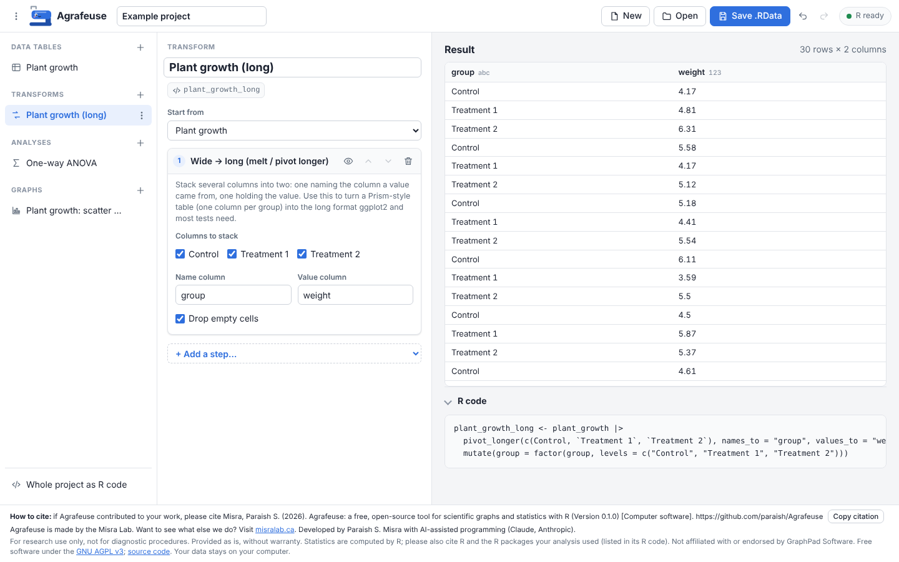
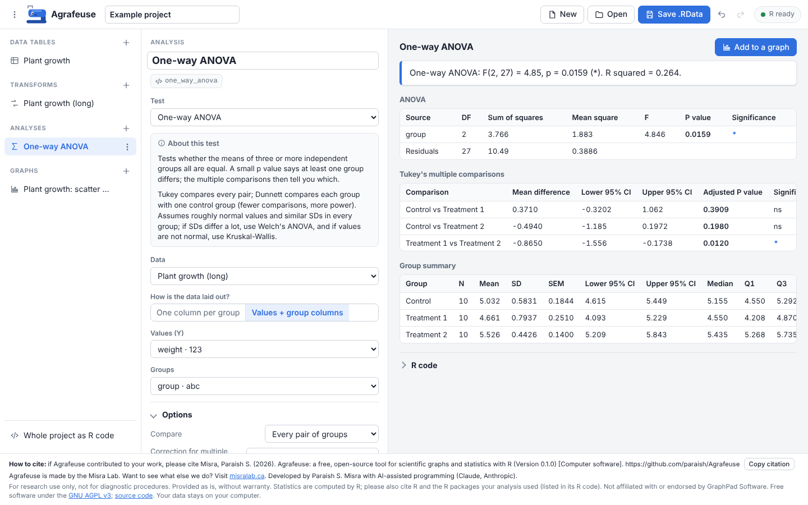

<p align="center"></p>

# Agrafeuse

*Agrafeuse* is French for stapler: it pins your data, statistics and figures together.

**Graphs and statistics with R and ggplot2, in your browser.** A free, open alternative to GraphPad Prism that gives you R's flexibility without writing code, and hands you the code when you want it.

- **No server, no install.** R runs inside the browser tab ([webR](https://docs.r-wasm.org/webr/latest/)). The app is a folder of static files you can host on GitHub Pages or open from your own computer.
- **Your data stays on your computer.** Nothing is uploaded anywhere.
- **Reproducible.** Every table, analysis and graph is real R code you can see, copy, and run in RStudio.
- **Save everything as `.RData`**, then reopen it in Agrafeuse, or `load()` it in R.



## What you can do

| | |
|---|---|
| **Enter data** | Type straight into a spreadsheet, paste a block from Excel, import CSV/TSV, open an `.RData` file, or start from a built-in R dataset. Column tables (one column per group, like Prism), XY tables and long tables. |
| **Transform** | Wide → long (melt / `pivot_longer`), long → wide, transpose, filter rows, reorder groups, rename, calculate a column with any R expression (log10, % of control, z-score…), change column types, keep/drop columns, summarise by group, sort, remove missing values. Steps chain together; the original table is never changed. |
| **Graph** | A layered ggplot2 builder. Each layer picks a dataset and one of 23 geoms (points, jitter, dot plot, bars at the mean, error bars, box, violin, histogram, lines, fitted lines, heatmap tiles, text, reference lines…). Each aesthetic (colour, fill, symbol, size, opacity, line type) is either mapped to a column or set to a fixed value. Press **Add layer** to stack more. Templates for the usual figures and a box for any extra ggplot2 code. Under the graph, a formatting panel sets axis titles and tick labels (size, **bold**, *italic*, underline, angle), scales (linear, log, square root, reversed), ranges, tick spacing and number formats, the graph title, font, themes (including a Prism-like "lab figure" look), palettes or per-group colours, the legend and panels (facets). Drag the graph's edges to resize it. |
| **Statistics** | t tests (unpaired / Welch, paired, ratio paired, one-sample), Mann-Whitney, Wilcoxon, one-way ANOVA with Tukey / Dunnett / Šidák / Bonferroni / Holm / FDR, Welch's ANOVA with Games-Howell, Kruskal-Wallis with Dunn's test, repeated-measures ANOVA, Friedman, two-way ANOVA (Type III or I) with simple-effects comparisons, mixed-effects models, correlation (Pearson, Spearman, Kendall), regression (linear, polynomial, log, exponential, power, 4-parameter dose-response with EC50, Michaelis-Menten, one-phase decay), descriptive statistics and normality tests. Each test has a plain-language explanation. |
| **Stats on graphs** | P value brackets (stars or numbers, stacked automatically, including comparisons between side-by-side groups in two-way designs), result text in a corner, fitted curves with confidence bands. |
| **Export** | PDF, SVG, PNG or TIFF at any size and resolution; the R script for the whole project; the project as `.RData`. |

| Data entry | Transforms | Statistics |
|---|---|---|
|  |  |  |

## Getting started

### Put it online with GitHub Pages (recommended)

1. Push this folder to a GitHub repository.
2. In the repository: **Settings → Pages → Build and deployment → Deploy from a branch**, choose `main` and `/ (root)`.
3. Open `https://<your-user>.github.io/<repository>/`.

It is still "local": the page is just files, and everything runs in each visitor's browser.

### Or run it on your computer

Browsers will not run webR from a file opened by double-clicking, so serve the folder with any static web server:

```sh
cd agrafeuse
python3 -m http.server 8000      # then open http://localhost:8000
```

The first start downloads R (about 30 MB) and a few R packages from the webR package repository. Your browser keeps them cached, so later starts take a few seconds. An example project (one dataset, taken through a transform, a one-way ANOVA and a graph) opens on first visit; **New** starts a blank one.

## Using your files in R

**Save .RData** writes every table, transform, analysis result and graph as R objects, plus the project itself (so Agrafeuse can reopen it):

```r
library(ggplot2)
load("Example_project.RData")

plant_growth_scatter_dot_plot                   # a ggplot: prints the figure
ggsave("figure1.pdf", plant_growth_scatter_dot_plot, width = 4, height = 4)

one_way_anova                                   # the analysis, printed as tables
one_way_anova$tables$ANOVA                      # each table is a data frame
summary(one_way_anova$model)                    # the fitted model itself
```

Opening a plain `.RData` file made in R (no Agrafeuse project inside) adds each of its data frames as a data table.

**Whole project as R code** (bottom of the left panel) gives one script that recreates everything, including the small `ag_…` helper functions Agrafeuse uses (Prism-like theme, p value brackets, result tables). It runs in R ≥ 4.1 with ggplot2 ≥ 3.5.

## How it works

```
┌──────────────────────────── your browser ────────────────────────────┐
│                                                                      │
│  Agrafeuse UI (plain JavaScript)                                     │
│    project = data tables + transforms + analyses + graphs (JSON)     │
│        │                                                             │
│        │  each item is turned into R code (js/codegen/)              │
│        ▼                                                             │
│  webR: R 4.6 compiled to WebAssembly, in a background worker         │
│    ggplot2 · dplyr · tidyr · emmeans · lme4 · R/helpers.R            │
│        │                                                             │
│        ▼                                                             │
│  SVG previews, result tables, PDF/PNG/TIFF/SVG files, .RData         │
└──────────────────────────────────────────────────────────────────────┘
   webR and R packages are downloaded once from webr.r-wasm.org and
   repo.r-wasm.org (falls back to cdn.jsdelivr.net for webR itself).
```

Items only re-run when their code, or something they depend on, changes. Previews are drawn by R's own Cairo SVG device, so what you see is what you export.

### Statistical methods

| Analysis | R code it runs |
|---|---|
| Unpaired / Welch t test | `t.test(y ~ group, var.equal = …)` |
| Paired / ratio paired t test | `t.test(x1, x2, paired = TRUE)` (ratio: on `log()` values, reported as geometric mean ratio) |
| Mann-Whitney / Wilcoxon | `wilcox.test(…, conf.int = TRUE)` |
| One-way ANOVA + multiple comparisons | `aov()`, then `emmeans::contrast(…, "pairwise" or "trt.vs.ctrl", adjust = …)` |
| Welch's ANOVA + Games-Howell | `oneway.test(var.equal = FALSE)`, `ag_games_howell()` |
| Kruskal-Wallis + Dunn | `kruskal.test()`, `ag_dunn()` (tie-corrected, `p.adjust()`) |
| Repeated-measures ANOVA | `lmerTest::lmer(y ~ group + (1 \| subject))` + `emmeans` |
| Friedman | `friedman.test()`, paired Wilcoxon post-tests |
| Two-way ANOVA | `lm()` with sum-to-zero contrasts and `drop1()` (Type III) or `anova()` (Type I); `emmeans` for comparisons |
| Mixed-effects model | `lmerTest::lmer()` with Satterthwaite degrees of freedom; `emmeans` |
| Correlation | `cor.test(method = "pearson" / "spearman" / "kendall")` |
| Regression | `lm()` for linear / polynomial / log; `nls()` with `SSfpl`, `SSmicmen`, `SSasymp` and others for curves |

If lme4 cannot be loaded in the browser, mixed models fall back to `nlme::lme()` automatically.

## Running offline, or self-hosting webR

By default webR comes from its CDN. To serve it yourself:

1. Download the release archive (e.g. `webr-0.6.0.tar.gz`) from [webR's GitHub releases](https://github.com/r-wasm/webr/releases) and extract it to `vendor/webr/`.
2. Open `http://localhost:8000/?webr=/vendor/webr/`, or change `webrSources` in `js/config.js`.

R packages still download from `repo.r-wasm.org` the first time. For a fully offline setup, mirror the packages you need with [rwasm](https://r-wasm.github.io/rwasm/) and point `repoUrl` in `js/config.js` at your copy.

## Using your own R instead of webR (optional)

If you have R installed, Agrafeuse can use it instead. This is faster for big datasets, and uses your installed packages:

```sh
node dev/r-bridge.mjs     # Node 18+; R needs ggplot2, dplyr, tidyr, jsonlite (+ emmeans, lme4, lmerTest)
```

It prints a link with a one-time token. The server only listens on `127.0.0.1` and rejects requests without the token.

## Project layout

```
index.html, css/app.css     the page
js/main.js                  start-up
js/model.js                 the project: items, R names, dependencies
js/codegen/                 project → R code (data, transforms, graphs, stats, whole script)
js/engine.js                runs R (webR or the bridge); caches results per item
js/ui/                      views: data grid, transforms, graph builder, statistics, dialogs
js/example.js               the example project
js/about.js                 name, version, citation and credits (shown in the footer)
assets/                     the stapler icon
R/helpers.R                 ag_* R functions: theme, brackets, result tables, drawing, .RData
dev/r-bridge.mjs            optional local server that uses your own R
tests/                      R helper tests, code-generation tests (in R), browser end-to-end tests, fixtures
```

There is no build step: edit a file and reload.

## Tests

```sh
Rscript tests/helpers_test.R                          # R helpers
R_SCRIPT=$(which Rscript) node tests/codegen.test.mjs # generated R code for ~100 configurations runs cleanly
R_SCRIPT=$(which Rscript) node tests/e2e.test.mjs     # drives the UI in Chromium (needs Playwright)
```

## Ideas for later

- **Controlled code entry.** Today you can type an R expression for a calculated column, and add any ggplot2 code to a graph or as a layer, both checked as you type. Next steps could be "R cell" items (your own transform or analysis written in R, with its output usable like any other dataset), column-name autocompletion, and a formula builder.
- Survival curves (Kaplan-Meier, log-rank), contingency tables (chi-square, Fisher), curve fits per group with comparisons, normalisation and baseline transforms.
- Multi-panel figures (patchwork), journal size presets, font choice.
- Excel (`.xlsx`) import.

## Known limitations

- The first start needs an internet connection and downloads roughly 30 MB for R plus the packages.
- webR is slower than desktop R. Tables of tens of thousands of rows are fine; much larger data is better handled with the R bridge.
- P value brackets are drawn between groups on the X axis, or between side-by-side groups within each X group. They are not split across panels (facets).
- Plots use the fonts that ship with webR. Text in PDFs and SVGs is embedded or outlined, so it looks the same everywhere.

## How to cite

If Agrafeuse contributed to your work, please cite it:

> Misra, Paraish S. (2026). Agrafeuse: a free, open-source tool for scientific graphs and statistics with R (Version 0.1.0) [Computer software]. https://github.com/paraish/Agrafeuse

In author-initial styles: Misra PS (Vancouver) or Misra, P. S. (APA).

GitHub's **Cite this repository** button (from `CITATION.cff`) gives APA and BibTeX. The statistics are computed by R, so please also cite R and the packages your analysis used (in R: `citation()`, `citation("ggplot2")`, `citation("emmeans")`, …).

Agrafeuse is made by the Misra Lab ([misralab.ca](https://misralab.ca/)). Developed by Paraish S. Misra with AI-assisted programming (Claude, Anthropic).

## License

Agrafeuse is free software under the GNU Affero General Public License v3 (`LICENSE`), with an
additional term under section 7(b): copies and modified versions must keep the author
attribution and the "How to cite" notice in the app's footer. See `NOTICE`.

R, webR and the R packages Agrafeuse loads at run time have their own licenses (R is GPL-2 | GPL-3).

For research use only, not for diagnostic procedures. Provided as is, without warranty.
Agrafeuse is not affiliated with or endorsed by GraphPad Software. GraphPad Prism is a trademark of GraphPad Software, LLC.
